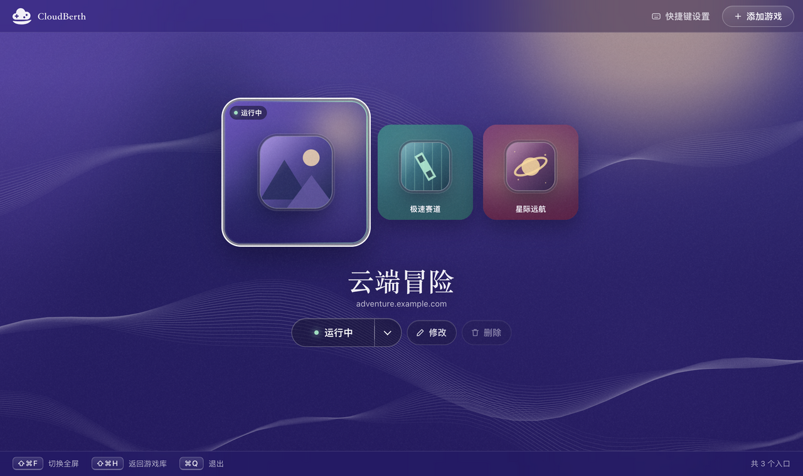
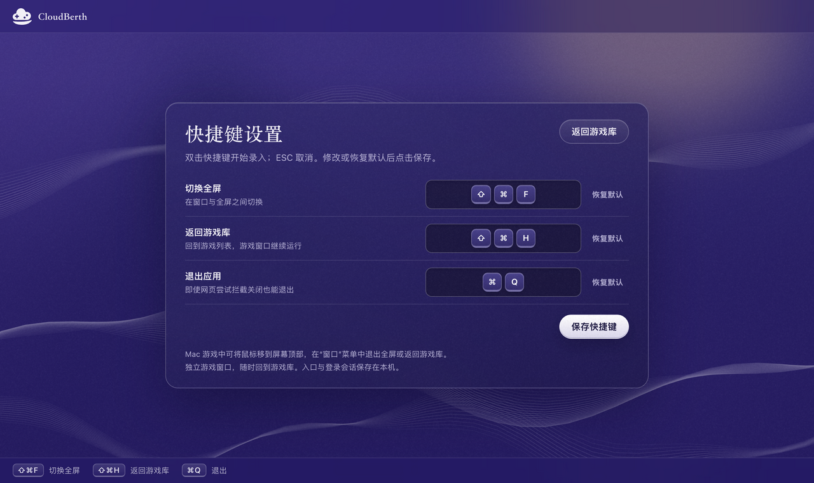
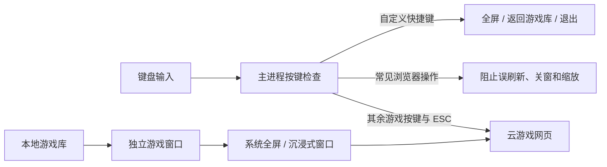

<p align="center"><strong>在这里请作者喝一瓶水</strong></p>

<p align="center">
  <a href="docs/images/afdian-tikzen.jpeg">
    
  </a>
</p>

---


<p align="center">一个专为网页云游戏打造的沉浸式体验空间</p>

<p align="center">
  <a href="https://github.com/Tikzen/CloudBerth/releases/latest"></a>
  <a href="#下载安装"></a>
  <a href="LICENSE"></a>
</p>

<p align="center">
  <a href="#下载安装">下载安装</a> ·
  <a href="#开始使用">开始使用</a> ·
  <a href="#开发与构建">开发与构建</a> ·
  <a href="https://github.com/Tikzen/CloudBerth/issues">反馈问题</a>
</p>

演示视频：www.bilibili.com/video/BV1Hc4J6tEis



<p align="center"><sub>界面截图来自 Mac 版。游戏名称、头像与运行状态均为演示数据，入口可自行添加；Windows 的快捷键和系统窗口控件有所不同。</sub></p>

## 为网页云游戏留一块专注的空间

在普通浏览器里玩云游戏，按键有时会触发刷新、关窗或缩放；ESC 可能退出全屏，切回游戏列表也会打断体验。

CloudBerth 提供专用的云游戏窗口：处理常见浏览器按键冲突，使用系统原生全屏，将游戏与启动器分开，让操作更接近独立游戏客户端。

**Mac 提供稳定版，Windows x64 提供预发布测试版（Pre-release）。**

- **独立游戏窗口**：启动器与游戏分离，返回游戏库时游戏页面继续保留，再次点击即可回到原窗口。
- **直观的运行状态**：按钮显示“运行中”，右侧菜单可结束指定游戏；重复点击会聚焦已有窗口。
- **自己的游戏库**：添加任意 HTTPS 游戏入口，自动获取网站图标，也支持使用本地图片作为头像。
- **更少的按键冲突**：拦截常见的刷新、关闭窗口、地址栏和缩放快捷键，减少游戏中误触浏览器操作。
- **沉浸式全屏**：使用 macOS 原生全屏，尽可能将 ESC 保留给游戏，并提供随时退出全屏和返回游戏库的入口。
- **可定制的快捷键**：双击录入，三个操作都能恢复默认；保存后，页脚提示与原生菜单同步更新。
- **干净的游戏环境**：以精简外壳集中承载游戏网页，不加载浏览器扩展，减少附加界面与功能带来的干扰和开销。
- **本地保存**：游戏库、偏好设置与网站会话存放在自己的设备上。

CloudBerth 基于 Electron，不提供云游戏算力或账号服务。游戏兼容性、画质与延迟由云游戏平台、网络和系统共同决定。

## 下载安装

| 平台 | 版本与状态 | 下载 |
| --- | --- | --- |
| macOS 13+ · Apple Silicon（M 系列） | **1.4.0 稳定版** | [DMG / ZIP](https://github.com/Tikzen/CloudBerth/releases/tag/v1.4.0) |
| Windows x64 | **1.4.0 测试版 · Pre-release** | [便携 EXE](https://github.com/Tikzen/CloudBerth/releases/tag/v1.4.0-windows-test) |

Mac 打开 DMG，将 **CloudBerth.app** 拖入“应用程序”后启动。当前 Mac 发行包使用本机临时签名，尚未完成 Apple Developer ID 签名与公证。

Windows 下载 `CloudBerth-1.4.0-x64.exe`，在 Windows 电脑上双击运行，无需安装。该版本为**未签名的预发布测试版**：已通过 Windows 环境中的启动器、窗口管理、Alt 快捷键、全屏、打包完整性与数据迁移自动化检查；真实云游戏串流、GPU、手柄及各平台登录兼容性仍需实机验证。

两个版本分别提供 SHA-256 校验文件。Mac 稳定版仍保留为 Latest；Windows 测试版单独标记为 Pre-release。Intel Mac 和 Linux 暂无经过验证的发行包。

## 开始使用

1. 打开 CloudBerth，点击“添加游戏”。
2. 填写游戏名称与 HTTPS 网页地址；使用网站图标，或选择自己的头像。
3. 点击“开始游戏”，在新窗口中进入云游戏平台。
4. 按返回游戏库快捷键切回启动器；点击“运行中”回到同一窗口。
5. 需要结束时，打开运行按钮右侧菜单，选择“结束游戏”。

首次启动使用通用示例网址，项目不预置维护者的个人游戏列表、配置或登录信息。删除游戏入口不会清除该网站的登录会话。

## 快捷键，随手调整



双击快捷键区域，按下想使用的组合，然后点击“保存快捷键”。ESC 取消录入，三个操作均提供“恢复默认”按钮。

| 操作 | Mac 稳定版 | Windows 测试版 |
| --- | --- | --- |
| 切换全屏 | ⇧⌘F | Alt + Shift + F |
| 返回游戏库 | ⇧⌘H | Alt + Shift + H |
| 退出应用 | ⌘Q | Alt + Q |

Windows 测试版使用 Alt 组合键，不要求 Command 键。[下载 Windows 测试版](https://github.com/Tikzen/CloudBerth/releases/tag/v1.4.0-windows-test)。

保存后，主页底部提示与 macOS 原生菜单里的组合键立即同步。三个组合不能重复；ESC 留给游戏，F12 留给调试工具。

Mac 游戏中将鼠标移到屏幕顶部，也可以通过“窗口”菜单退出全屏或返回游戏库。网页本身可能使用 ESC 解除鼠标锁定或网页全屏。

## 软件内更新

顶部点击“检查更新”（Mac 原生应用菜单中也可操作）。正式版启动 15 秒后及每 6 小时检查一次 GitHub Releases；自动发现更新时显示说明，可选“立即更新”或“跳过此版本”。游戏运行中不自动弹窗，返回启动器并结束游戏后提示。手动检查可以重新查看已跳过的版本。

点击“立即更新”后直接在软件中下载，显示进度、下载大小，可取消；SHA-256 校验与安装准备完成后，结束正在运行的游戏，点击“重启并更新”。本地游戏库、设置与登录数据保留，替换失败时尝试恢复旧程序。

Mac 只读取包含对应架构 Mac ZIP 和 `SHA256SUMS.txt` 的非预发布版本；Windows 读取包含对应架构便携 EXE 和 `SHA256SUMS-windows.txt` 的版本（包括 Windows 测试版）。不会把其他系统的 Release 作为本机更新。

Mac 请先将应用放入可写的本地目录（通常为“应用程序”），不要从 DMG 中直接更新；Windows 从便携 EXE 启动，并确保文件所在目录可写。更新不申请管理员权限。1.3.x 尚无版本检查，需要先手动升级到 1.4.0，此后才能使用软件内更新。

## 工作原理

CloudBerth 使用 Electron / Chromium 加载云游戏平台。游戏内容和串流仍由原网站提供，外壳负责按键、窗口和会话管理。



### 按键冲突如何处理

主进程在网页收到按键前识别应用快捷键和常见浏览器操作，拦截刷新、关窗等容易误触的组合，其余按键继续交给游戏。macOS 原生菜单也注册相同的应用快捷键，作为全屏与返回游戏库的操作入口。

系统级快捷键仍由操作系统处理；网页自己的鼠标锁定或 HTML 全屏可能使用 ESC 解锁。CloudBerth 的原生全屏不会主动用 ESC 退出，尽量保留游戏需要的输入行为。

### 全屏与游戏窗口如何分离

启动器和每个游戏分别使用独立窗口。游戏的沉浸显示由系统原生全屏承载，无需依赖网页的全屏按钮；需要退出时，可使用自定义快捷键或系统菜单。

返回游戏库时隐藏已有游戏窗口，不刷新或销毁页面；再次打开时聚焦原窗口。运行状态由主进程维护，结束游戏才关闭对应窗口。

### 干净与性能

精简的界面与功能边界，目标是减少无关页面、浏览器扩展和附加功能造成的干扰与额外开销，让资源更集中于游戏本身。保留 Chromium 的硬件加速、WebRTC 和游戏输入能力，不额外添加视频处理管线。

实际帧率、内存占用与延迟仍取决于设备、解码方式、网络和云游戏平台。当前没有提供与通用浏览器的量化性能对比，多开游戏也会增加资源占用。

## 本地数据与升级

| 系统 | 数据目录 |
| --- | --- |
| macOS | `~/Library/Application Support/CloudBerth/` |
| Windows | `%APPDATA%/CloudBerth/` |

- `config.json`：应用偏好。
- `launcher.json`：游戏入口、头像与快捷键。
- `window-state.json`：窗口位置。
- `Partitions/cloud-game/`：网站会话与存储。
- `logs/cloudberth.log`：应用日志。

从旧版 CloudGameShell 升级时，先退出旧应用。CloudBerth 在首次运行且新目录没有配置时迁移旧数据，并保留原目录；已有 CloudBerth 配置优先使用。macOS Cookie 会通过隔离迁移进程重新加密，明文不写入文件或日志、不上传。网站仍可能根据自己的会话策略要求重新登录。

迁移实现与验证范围见 [MACOS.md](MACOS.md)。

## 开发与构建

需要 **Node.js 22.12+** 和 npm。当前使用 Electron 45.2.3、electron-builder 26.18.0。

```sh
# Mac 稳定分支
git clone --branch macos https://github.com/Tikzen/CloudBerth.git CloudBerth
cd CloudBerth
npm ci
npm start
```

默认模板为 config.default.json，游戏和设置通过界面管理。不要将个人 config.json、launcher.json 或会话目录提交到仓库。

在 Mac 上构建：

```sh
npm run dist:mac        # 当前发行目标：Apple Silicon Mac
npm run dist:mac:intel  # 开发构建目标：Intel Mac，尚未实机验证
```

产物默认输出到 dist/。macOS 生成 DMG 与 ZIP。

Windows 源码单独维护在 [windows 分支](https://github.com/Tikzen/CloudBerth/tree/windows)，建议放在独立目录：

```sh
git clone --branch windows https://github.com/Tikzen/CloudBerth.git "CloudBerth for Windows"
cd "CloudBerth for Windows"
npm ci
npm run dist:win -- --config.directories.output=dist/windows
```

在 Windows 上执行构建命令。详细构建、测试与默认快捷键说明见 [Windows 开发说明](https://github.com/Tikzen/CloudBerth/blob/windows/WINDOWS.md)。

### 检查与测试

```sh
npm run check
npm run test:launcher
npm run test:close
npm run test:runtime
npm run test:shortcuts
npm run test:identity
npm run test:mac
```

集成测试使用隔离临时目录。窗口测试会短暂显示窗口并切换全屏；test:mac 仅适用于 macOS，Windows 分支另提供 `npm run test:win`，test:runtime 的网站图标检查需要网络。

开发者可运行 `npm run test:manual` 检查 ESC、鼠标锁定、手柄输入和全屏。开发测试页面、截图生成脚本与 tools/tmp 不进入正式安装包。README 截图可通过 `node tools/run.js screenshots` 重新生成，仅使用示例数据。

### 项目结构

```text
main.js                 应用启动与主进程装配
src/launcher/           本地启动器界面与静态资源
src/runtime.js          独立游戏窗口与可信 IPC
src/identity.js         应用身份与旧数据迁移
src/library.js          游戏库与快捷键持久化
src/platform.js         macOS 菜单和平台默认值
src/shortcuts.js        原生按键录入与全屏切换
src/icons.js            网站与自定义头像处理
src/preload.js          本地启动器受限桥接
build/                  应用图标
tools/                  开发检查与隔离测试
docs/images/            README 界面截图
```

详细接口与前端交接说明见 [FRONTEND_HANDOFF.md](FRONTEND_HANDOFF.md)。发布流程见 [PUBLISHING.md](PUBLISHING.md)。

## 来源与许可

CloudBerth 基于 [sheepandriy/cloud-game-shell](https://github.com/sheepandriy/cloud-game-shell) 开发并独立维护，感谢原作者提供基础实现。

在原项目基础上增加 macOS 适配、独立游戏窗口、运行状态管理、自动与自定义头像、原生快捷键录入、数据迁移及新版界面和品牌。

代码沿用 **MIT**，见 [LICENSE](LICENSE)。上游在 package.json 中声明 MIT，未附独立许可文件；来源与素材说明记录于 [THIRD_PARTY_NOTICES.md](THIRD_PARTY_NOTICES.md)。新增贡献的版权说明不替代上游归属。
